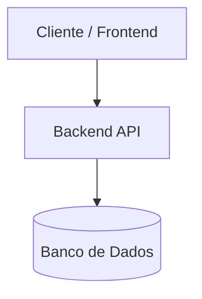

# {{name}}

## Visão Geral

Descrição técnica da arquitetura do sistema, seus princípios de design e objetivos.

## Diagrama da Arquitetura

## Componentes do Sistema

- **Frontend:** [[Aplicação]]
- **Backend:** [[Serviço]]
- **Banco de Dados / Armazenamento:** [[Serviço]]
- **Mensageria / Filas / Cache:** [[Serviço]]
- **Servidores Hospedeiros:** [[Servidor]]

## Comunicação e Fluxos de Dados

- Protocolos (HTTP/REST, gRPC, WebSocket)
- Portas e rotas principais
- Estratégia de autenticação e autorização

## Decisões Técnicas Relacionadas

- [[ADR-...]]
